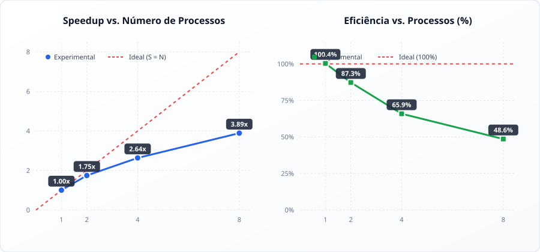
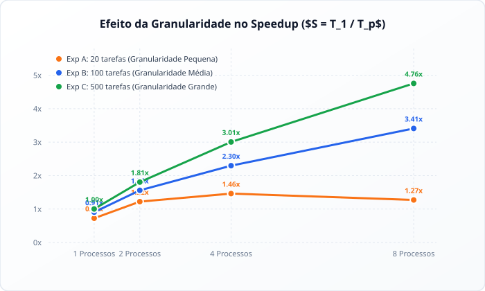
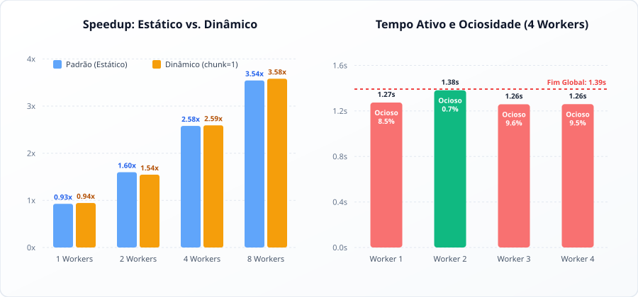
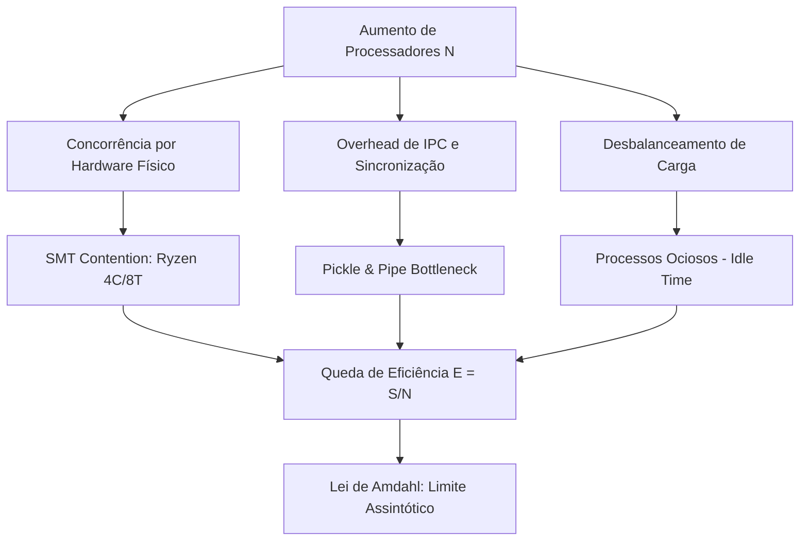

# Atividade Prática 01: Computação Paralela e Distribuída

Este repositório contém o desenvolvimento, experimentação empírica e análise teórica da **Atividade Prática 01** da disciplina de **Computação Paralela e Distribuída** (8º Período).

O objetivo é investigar na prática as métricas de desempenho computacional paralelo (**Speedup**, **Eficiência** e **Overhead**), os impactos da **Granularidade** das tarefas, os desafios de **Balanceamento de Carga** em sistemas heterogêneos e a validação empírica da **Lei de Amdahl**.

---

## 🖥️ 1. Ambiente Experimental e Configuração de Hardware

Para que as análises de desempenho façam sentido técnico, todas as medições foram executadas e registradas na seguinte arquitetura física:

| Componente | Especificação |
| :--- | :--- |
| **Processador (CPU)** | AMD Ryzen 5 3400G with Radeon Vega Graphics |
| **Núcleos Físicos** | **4 núcleos** |
| **Processadores Lógicos (Threads)** | **8 threads** (via SMT / Simultaneous Multithreading) |
| **Frequência Base / Turbo** | 3.7 GHz / 4.2 GHz |
| **Memória RAM** | 16 GB DDR4 |
| **Sistema Operacional** | Windows 10 / 11 64-bit |
| **Linguagem / Interpretador** | Python 3.12.9 (64-bit) |
| **Biblioteca de Paralelismo** | `concurrent.futures.ProcessPoolExecutor` |

> [!IMPORTANT]
> **Relevância Arquitetural da CPU**: Por possuir **4 núcleos físicos** e **8 threads lógicas**, este hardware é ideal para observar o comportamento do escalonamento paralelo:
> - Até **4 processos**, cada processo pode ocupar um núcleo físico dedicado com pipeline e unidades de execução exclusivas.
> - Entre **4 e 8 processos**, o ganho depende do compartilhamento das unidades funcionais (ALUs/FPUs) entre as duas threads do mesmo núcleo físico (SMT), aumentando a disputa por cache L1/L2 e a sobrecarga de escalonamento.

---

## 📁 2. Estrutura do Repositório

```text
Atv Pratica 01/
├── assets/
│   ├── speedup_eficiencia.svg          # Gráfico vetorial de Speedup e Eficiência
│   ├── granularidade_comparacao.svg    # Comparativo dos experimentos de granularidade
│   └── balanceamento_carga.svg         # Comparativo estático vs dinâmico e ociosidade
├── src/
│   ├── etapa1_sequencial.py            # Execução sequencial autônoma (Etapa 1)
│   ├── etapa2_paralelo.py              # Execução paralela autônoma com métricas (Etapa 2 e 3)
│   ├── etapa5_granularidade.py         # Teste empírico de granularidade (Etapa 5)
│   ├── etapa6_balanceamento.py         # Teste de balanceamento e telemetria (Etapa 6)
│   ├── benchmark_completo.py           # Orquestrador automatizado de testes
│   └── gerar_graficos.py               # Gerador autônomo dos gráficos vetoriais em SVG
├── resultados_experimentais.json       # Dados brutos coletados em formato estruturado
├── .gitignore                          # Arquivos ignorados pelo controle de versão
└── README.md                           # Relatório técnico completo (este documento)
```

---

## ⏱️ 3. ETAPAS 1, 2 e 3 – Resultados Experimentais

A tarefa computacional consiste em calcular para cada número $n$ a soma acumulada de $((n \times i) \pmod{97})$ ao longo de 300.000 iterações por tarefa.

Para neutralizar flutuações e ruídos momentâneos do sistema operacional (trocas de contexto, processos em segundo plano), foram executadas **3 repetições completas** para cada cenário, computando-se as médias aritméticas e desvios padrão.

### 📊 Tabela Oficial de Resultados (100 tarefas)

$$Speedup = \frac{T_1}{T_p} \qquad\qquad Efici\hat{e}ncia = \frac{Speedup}{N}$$

| Número de Processos ($N$) | Tempo Médio de Execução ($T_p$) | Desvio Padrão ($\sigma$) | Speedup ($S$) | Eficiência ($E$) |
| :---: | :---: | :---: | :---: | :---: |
| **1 (Sequencial $T_1$)** | **3,0026 s** | $\pm 0,1376\text{ s}$ | **1,00** | **100,00%** |
| **1 (ProcessPool)** | 2,9919 s | $\pm 0,1659\text{ s}$ | 1,00 | 100,36% |
| **2** | **1,7199 s** | $\pm 0,0496\text{ s}$ | **1,75** | **87,29%** |
| **4** | **1,1392 s** | $\pm 0,0646\text{ s}$ | **2,64** | **65,89%** |
| **8** | **0,7722 s** | $\pm 0,0092\text{ s}$ | **3,89** | **48,61%** |

### 📈 Visualização Gráfica de Desempenho



---

## 🔍 4. ETAPA 4 – Análise Técnica dos Resultados

### 1. O speedup obtido foi igual ao número de processos utilizados? Justifique.
**Não.** Em nenhuma das configurações paralelas ($N = 2, 4, 8$) o speedup atingiu o valor linear ideal ($S = N$).
- Para **2 processos**, o speedup atingido foi de **1,75x** (ideal seria 2,00x).
- Para **4 processos**, o speedup foi de **2,64x** (ideal seria 4,00x).
- Para **8 processos**, o speedup foi de **3,89x** (ideal seria 8,00x).

**Justificativa:** Em um sistema computacional real, a execução paralela nunca ocorre sem custo adicional. Existe uma fração inerentemente serial no programa (como a inicialização da aplicação, instanciação do pool de processos, iteração sobre a lista de entrada e coleta dos resultados). Além disso, a comunicação entre processos impõe sobrecargas que consomem ciclos de CPU que não existiam na versão sequencial pura.

### 2. A eficiência permaneceu próxima de 100%? Explique.
**Não.** A eficiência começou em **87,29%** com 2 processos, caiu para **65,89%** com 4 processos e desceu para **48,61%** com 8 processos.

**Explicação:** A eficiência mede a fração de tempo em que os processadores estão efetivamente dedicados ao cálculo útil do problema versus o tempo desperdiçado em overhead e ociosidade:
$$E = \frac{Speedup}{N} = \frac{T_1}{N \cdot T_p}$$
À medida que $N$ aumenta, o denominador ($N \cdot T_p$) cresce mais rápido do que a redução no tempo de execução, porque:
1. Mais processos competem por recursos compartilhados (barramento de memória RAM, controlador de memória e cache L3 unificado).
2. O overhead de IPC (*Inter-Process Communication*) e serialização de dados cresce com o aumento no número de processos receptores.
3. Nos 8 processos, entra em jogo o compartilhamento das unidades físicas de execução dos 4 núcleos da CPU pelo SMT (Simultaneous Multithreading).

### 3. O que aconteceu com o tempo de execução à medida que a quantidade de processos aumentou?
O tempo de execução decresceu monotonicamente: reduziu de **3,0026 s** (sequencial) para **1,7199 s** ($N=2$), depois para **1,1392 s** ($N=4$) e finalmente para **0,7722 s** ($N=8$). Embora o tempo continue caindo, a **taxa de redução temporal foi decrescente**:
- De 1 para 2 workers: ganho de **1,28 s** economizados.
- De 2 para 4 workers: ganho de **0,58 s** economizados.
- De 4 para 8 workers: ganho de apenas **0,37 s** economizados.

### 4. Em algum momento o ganho de desempenho começou a diminuir?
**Sim, a partir da transição de 4 para 8 processos**, o ganho marginal sofreu clara desaceleração (retornos decrescentes).
- Ao dobrar de 2 para 4 processos, a aceleração relativa foi de $\frac{2,64}{1,75} \approx 1,51\text{x}$.
- Ao dobrar de 4 para 8 processos, a aceleração relativa caiu para $\frac{3,89}{2,64} \approx 1,47\text{x}$, e a eficiência despencou para menos da metade (**48,61%**).

**Razão Arquitetural:** O processador utilizado (AMD Ryzen 5 3400G) possui **apenas 4 núcleos físicos reais**. Ao alocar 8 processos trabalhadores, o escalonador do sistema operacional utiliza threads lógicas via tecnologia SMT (*Simultaneous Multithreading*). Threads lógicas não duplicam as unidades de cálculo de ponto flutuante ou inteiros da CPU; elas apenas aproveitam bolhas de inatividade (*pipeline stalls*). Em cálculos matemáticos intensivos contínuos como o do loop da função `tarefa`, os pipelines permanecem 100% ocupados, gerando concorrência direta e saturação das unidades de execução físicas.

### 5. Quais possíveis fontes de overhead estão presentes nessa aplicação?
1. **Criação e Inicialização de Processos (`multiprocessing`)**: No Windows, processos não utilizam `fork()` como no Linux; eles utilizam a API `CreateProcess` com *spawn*, exigindo que o interpretador Python seja reinicializado do zero para cada novo processo worker, carregando módulos e bibliotecas em novos espaços de endereçamento virtual.
2. **Serialização de Dados (*Pickling* e *Unpickling*)**: Para transferir tarefas do processo principal para os processos filhos e receber os resultados, o Python converte objetos em fluxos de bytes binários usando o módulo `pickle`, demandando computação e consumo de memória.
3. **Comunicação Inter-Processos (IPC)**: O tráfego de dados trafega através de primitivas do sistema operacional (Pipes anônimos do Windows ou sockets locais), exigindo chamadas de sistema (*syscalls*) e cópias intermediárias de buffers no kernel.
4. **Trocas de Contexto (*Context Switches*)**: Com 8 processos de computação pesada somados aos processos do sistema operacional e da interface gráfica, a CPU precisa alternar constantemente o contexto de execução nos registradores e invalidar linhas de cache L1/L2.
5. **Sincronização e Coleta (*Barrier Synchronization*)**: O comando `list(executor.map(...))` atua como uma barreira síncrona; o processo principal deve aguardar o término do último worker para consolidar a lista final.

---

## 🔬 5. ETAPA 5 – Experimento de Granularidade

Nesta etapa, variou-se o número de tarefas mantendo o custo computacional unitário idêntico:
- **Experimento A**: 20 tarefas (`range(1, 21)`) — Granularidade Pequena (Fina).
- **Experimento B**: 100 tarefas (`range(1, 101)`) — Granularidade Média.
- **Experimento C**: 500 tarefas (`range(1, 501)`) — Granularidade Ampla (Grossa).

### 📊 Resultados Experimentais Obtidos

| Experimento | Qtd. Tarefas | Tempo Seq. ($T_1$) | 1 Worker | 2 Workers | 4 Workers | 8 Workers | Speedup Máx. | Efic. com 8 Workers |
| :--- | :---: | :---: | :---: | :---: | :---: | :---: | :---: | :---: |
| **A (Pequena)** | 20 | 0,5176 s | 0,7141 s | 0,4235 s | 0,3539 s | **0,4072 s** | **1,46x** (em 4 W) | **15,89%** |
| **B (Média)** | 100 | 2,6758 s | 2,9468 s | 1,7154 s | 1,1645 s | 0,7849 s | **3,41x** | **42,62%** |
| **C (Grande)** | 500 | 14,5600 s | 14,5215 s | 8,0646 s | 4,8435 s | 3,0620 s | **4,76x** | **59,44%** |

### 📈 Comparativo Visual de Granularidade



### 💬 Respostas às Questões da Etapa 5:

#### Como a quantidade de tarefas influencia o aproveitamento dos processos?
Quanto maior a quantidade de tarefas (ou o volume total de trabalho computacional), melhor é o aproveitamento dos processos. No Experimento C (500 tarefas), o tempo total de computação é substancial (~14,5s), permitindo que todos os 8 workers trabalhem em sua capacidade máxima durante tempo suficiente para que o ganho do paralelismo supere amplamente os custos fixos de inicialização e sincronização, alcançando um speedup de **4,76x**.

#### Tarefas muito pequenas podem prejudicar o desempenho? Por quê?
**Sim, drasticamente.** No Experimento A (20 tarefas), o speedup com 8 workers foi de apenas **1,27x** e o tempo de execução foi de **0,4072 s**, sendo **mais lento do que com 4 workers (0,3539 s)**.
Isso ocorre porque com 20 tarefas e 8 processos, cada processo executa em média apenas 2,5 tarefas. O tempo necessário para o sistema operacional criar os 8 processos, alocar pipes IPC e empacotar dados com pickle supera o próprio tempo que a CPU gasta executando a tarefa.

#### O que acontece quando o custo de distribuir e gerenciar uma tarefa se torna comparável ao custo do próprio processamento?
Ocorre a degradação do sistema paralelo, fenômeno conhecido como **paralelismo negativo** ou **desaceleração paralela**. Quando $T_{\text{overhead}} \ge T_{\text{cálculo}}$, a versão paralela torna-se mais lenta que a versão sequencial. Nota-se que no Experimento A com 1 worker no `ProcessPool`, o tempo foi de **0,7141 s**, enquanto o sequencial puro levou apenas **0,5176 s** (speedup de **0,72x** — perda de 28% de desempenho unicamente pelo custo de gerenciamento do pool).

#### Como os resultados se relacionam com o conceito de granularidade?
A **granularidade** é definida pela razão entre a quantidade de computação útil e a quantidade de comunicação/overhead:
$$\text{Granularidade} = \frac{T_{\text{computação}}}{T_{\text{comunicação}}}$$
- **Granularidade Fina (Exp A)**: Pouco processamento por tarefa. O overhead de comunicação domina, gerando baixa eficiência (**15,89%** com 8 workers).
- **Granularidade Grossa (Exp C)**: Alto volume de processamento para cada rodada de comunicação. O overhead torna-se percentualmente desprezível, resultando em alta eficiência (**59,44%** com 8 workers) e excelente aceleração.

---

## ⚖️ 6. ETAPA 6 – Desafio de Balanceamento de Carga

Na Etapa 6, a função de trabalho foi modificada para introduzir heterogeneidade estocástica na carga:
```python
def tarefa(numero):
    if numero % 10 == 0:
        limite = 1_500_000  # 5x mais iterações (tarefa pesada)
    else:
        limite = 300_000    # Tarefa padrão
```
Neste cenário, 10% das entradas (10 tarefas) exigem **5 vezes mais processamento** que as outras 90 tarefas normais.

### 📊 Resultados Experimentais: Estático vs. Dinâmico

| Processos ($N$) | Tempo Padrão (Estático) | Speedup Padrão | Tempo Dinâmico (`chunksize=1`) | Speedup Dinâmico |
| :---: | :---: | :---: | :---: | :---: |
| **1** | 4,2027 s | 0,93x | 4,1221 s | 0,94x |
| **2** | 2,4367 s | 1,60x | 2,5188 s | 1,54x |
| **4** | 1,5088 s | 2,58x | 1,5015 s | 2,59x |
| **8** | 1,0982 s | 3,54x | 1,0867 s | 3,58x |

### 🛰️ Telemetria dos Processos em Execução (4 Workers)

Para comprovar a existência de ociosidade, o script `etapa6_balanceamento.py` monitorou individualmente cada worker por PID durante a execução com 4 processos:

| Processo (Worker) | PID do SO | Tempo em Computação Ativa | Tempo Ocioso / Espera | Percentual de Ociosidade |
| :--- | :---: | :---: | :---: | :---: |
| **Worker 1** | 14736 | 1,2739 s | 0,1179 s | **8,47%** |
| **Worker 2** | 9300 | **1,3814 s** | 0,0104 s | **0,75% (Gargalo / Straggler)** |
| **Worker 3** | 13388 | 1,2585 s | 0,1332 s | **9,57%** |
| **Worker 4** | 15048 | 1,2595 s | 0,1323 s | **9,50%** |
| **Tempo Total do Pool** | - | **1,3918 s** | - | **Barreira Síncrona Final** |

### 📈 Gráficos de Balanceamento de Carga



### 💬 Respostas às Questões da Etapa 6:

#### Todos os processos terminam aproximadamente no mesmo momento?
**Não.** Os dados empíricos de telemetria demonstram claramente que o **Worker 2 (PID 9300)** permaneceu ativo calculando durante **1,3814 s**, enquanto os Workers 1, 3 e 4 terminaram suas tarefas com ~1,25 s a 1,27 s. Os processos mais rápidos foram forçados a aguardar o Worker 2 concluir o processamento antes que a barreira global pudesse ser liberada.

#### O balanceamento de carga foi adequado? Justifique.
**Não foi adequado.** O escalonador padrão atribui blocos (*chunks*) prévios aos workers. Como os números múltiplos de 10 caíram de maneira desproporcional entre os blocos pré-alocados, o Worker 2 recebeu uma concentração maior de tarefas pesadas de 1.500.000 iterações, enquanto os outros workers receberam tarefas mais leves.

#### É possível que alguns processos fiquem ociosos enquanto outros ainda executam tarefas?
**Sim.** A tabela comprova que os **Workers 1, 3 e 4 ficaram ociosos entre 8,47% e 9,57% do tempo total de execução**. Durante esse intervalo de inatividade forçada (*idle time*), os núcleos físicos correspondentes ficaram sem trabalho útil, desperdiçando a capacidade computacional agregada do processador.

#### Como uma estratégia de distribuição dinâmica poderia melhorar o balanceamento?
Em vez do particionamento estático em blocos fixos, uma estratégia de distribuição dinâmica implementa uma **fila atômica de tarefas centralizada (modelo Produtor-Consumidor)** ou o parâmetro `chunksize=1`:
1. Cada worker busca uma única tarefa por vez.
2. O worker que recebe a tarefa pesada (1.500.000 iterações) gasta mais tempo nela, mas os outros workers livres continuam consumindo e finalizando as tarefas restantes de 300.000 iterações da fila.
3. Isso evita que múltiplos itens leves fiquem retidos atrás de uma tarefa longa na mesma partição estática, reduzindo a variância do tempo de término entre os nós (*work stealing*).

#### Dividir o trabalho em tarefas menores poderia melhorar a distribuição da carga? Qual seria o impacto no overhead?
- **Efeito Positivo**: Dividir o trabalho em unidades menores (maior fine-grained decomposition) permite distribuir a carga com precisão muito mais homogênea entre os núcleos, eliminando a discrepância causada por grandes tarefas indivisíveis.
- **Impacto no Overhead**: Cada tarefa adicional requer uma mensagem IPC, serialização via `pickle`, empacotamento no buffer e despacho de evento de sincronização. Se a divisão for excessiva, o custo cumulativo de despachar milhares de microtarefas anula o benefício do balanceamento de carga (conforme demonstrado no Experimento A da Etapa 5).

---

## 🏛️ 7. Análise Integrada do ED 01: Validação da Lei de Amdahl

### Os resultados obtidos confirmam que adicionar mais processadores não produz necessariamente um ganho proporcional de desempenho?
**Sim, confirmam de maneira inequívoca.** 

Essa constatação fundamental da Computação Paralela é regida e formalizada pela **Lei de Amdahl**:

$$S(N) = \frac{1}{(1 - P) + \frac{P}{N}}$$

Onde:
- $S(N)$ é o speedup obtido com $N$ processadores.
- $P$ é a fração estritamente paralelizável do código.
- $(1 - P)$ é a fração estritamente serial do código (overhead fixo, criação de processos, agregação final).

### 📐 Estimativa Matemática da Fração Serial no Experimento

A partir dos resultados obtidos na **Etapa 3** com 4 processos ($S(4) = 2,64$):
$$2,64 = \frac{1}{(1 - P) + \frac{P}{4}} \implies (1 - P) + 0,25P = \frac{1}{2,64} \approx 0,3788$$
$$1 - 0,75P = 0,3788 \implies 0,75P = 0,6212 \implies P \approx 0,8283 \quad (82,8\%)$$
$$\text{Fração Serial } (1 - P) \approx 0,1717 \quad (17,2\%)$$

Mesmo que o algoritmo matemático da função `tarefa` seja teoricamente embaraçosamente paralelo (*embarrassingly parallel*), a infraestrutura do sistema (IPC, `multiprocessing`, `pickle`, barreira de retorno do pool) introduz uma **fração serial efetiva de aproximadamente 17%**.

### 🎯 Limite Assintótico Máximo de Speedup

Pela Lei de Amdahl, quando o número de núcleos tende ao infinito ($N \to \infty$):
$$S_{\max} = \lim_{N \to \infty} S(N) = \frac{1}{1 - P} = \frac{1}{0,1717} \approx 5,82\text{x}$$

Isso significa que, **independentemente de quantos processadores forem adicionados** (sejam 16, 64 ou 1.000 núcleos), este programa específico com este volume de dados **nunca superará um speedup de 5,82 vezes**, demonstrando que o ganho não é e nunca poderá ser proporcional ao número de nós alocados.

### 🔗 Síntese Conceitual Articulada



1. **Speedup vs. Eficiência**: À medida que elevamos a contagem de núcleos para tentar maximizar o speedup, a eficiência obrigatoriamente declina devido ao crescimento dos termos de coordenação.
2. **Overhead**: O custo de instanciação de processos, cópia de memória entre espaços de endereçamento distintos e trocas de contexto pelo kernel atua diretamente na fração serial $(1 - P)$.
3. **Granularidade**: Determina o limiar no qual a paralelização se justifica. Se o problema for pequeno (granularidade fina), o overhead supera a computação ($S < 1$). Em problemas maiores (granularidade grossa), o speedup aproxima-se do potencial máximo.
4. **Balanceamento de Carga**: O tempo de conclusão global de uma barreira paralela é ditado pelo nó mais lento (*slowest worker* / gargalo da cauda). A ociosidade dos demais núcleos degrada a eficiência global, confirmando a necessidade de mecanismos dinâmicos em cargas heterogêneas.

---

## 🚀 8. Instruções de Reprodução e Execução

Para reproduzir todos os experimentos e gerar novamente as tabelas e gráficos em qualquer ambiente:

### 1. Clonar o repositório
```bash
git clone https://github.com/SEU_USUARIO/atv-pratica-01.git
cd atv-pratica-01
```

### 2. Configurar o Ambiente Python
Recomenda-se Python 3.10 ou superior. Não são necessárias bibliotecas pesadas de terceiros (o projeto utiliza a biblioteca padrão do Python e um gerador nativo de vetores SVG):
```bash
python -m venv .venv
# No Windows:
.venv\Scripts\activate
# No Linux/macOS:
source .venv/bin/activate
```

### 3. Executar os Módulos Individuais
```bash
# Etapa 1 - Sequencial
python src/etapa1_sequencial.py

# Etapa 2 e 3 - Paralelo e Tabela
python src/etapa2_paralelo.py

# Etapa 5 - Experimentos de Granularidade
python src/etapa5_granularidade.py

# Etapa 6 - Desafio de Balanceamento de Carga
python src/etapa6_balanceamento.py
```

### 4. Executar a Bateria Completa de Testes
```bash
python src/benchmark_completo.py
```

### 5. Regerar os Gráficos
```bash
python src/gerar_graficos.py
```

---

## 👨‍💻 Autoria
- **Disciplina**: Computação Paralela e Distribuída
- **Período**: 8º Período — Ciência da Computação / Engenharia de Software
- **Atividade**: Atividade Prática 01 (Módulo 01 / ED 01)
